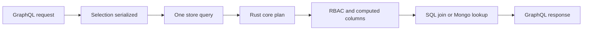

# store-graphql

**A standard GraphQL API generated from the JSON schema you already registered — one client request becomes one `store.query`.**


Chinese docs: [README.zh-CN.md](./README.zh-CN.md) · Production guardrails: [DEPLOYMENT.md](./DEPLOYMENT.md)

- The schema is the only source of truth — no second type system, no hand-written SDL.
- Every field rides the store's existing semantics: RBAC, computed columns, relations, dialect routing.
- Current release: `0.6.2` (Node ≥ 18, Python ≥ 3.10, plus a v0 Go adapter in `go/`).

## Nine requests for one screen

At 8:40 on a Monday, a course detail screen opens on a phone in a subway tunnel. Before the first line of text appears, the app has sent nine requests: the course, its category, its teacher, four lessons, a review summary, and the viewer's enrollment. Nine round trips; nine chances for one of them to time out; nine separate reads against the same database, most of them fetching columns the screen never renders. On a 120 ms connection the wait is not caused by the database. It is caused by the shape of the conversation.

The screen needed one tree. The client asked for nine lists.

`store-graphql` makes that tree a single request, and that request a single `store.query`. It reflects the JSON schema you already registered into a standard GraphQL schema, serializes the client's selection into the data layer's existing GQL projection, and lets the Rust core resolve nested fields, computed columns, permissions and dialect differences in one plan. Nine requests become one; the server never writes a second query for a child list.

## What it actually does

It is a protocol skin, not a data layer. For every writable model the store knows about, it generates the type, two query roots and three mutation roots, then hands execution back to the same engine the REST and gRPC skins use.

| You declare in the JSON schema | GraphQL surface gets |
|---|---|
| model `User` | `type User`, `getUser`, `listUser`, `createUser`, `updateUser`, `deleteUser` |
| `_id` | `ID!`; every other field is nullable |
| `string`, `datetime` | `String` — datetime is passed through as an ISO string |
| `int` / `float` / `bool` | `Int` / `Float` / `Boolean` |
| `object` with `fields` | nested object type named `<Parent>_<fieldPath>`, walked recursively |
| `object` without `fields`, `array`, unknown type | the `JSON` custom scalar |
| `computes.<name>` | an ordinary field using the type declared on the computed column |
| `_score` | `Float`, nullable, injected into every model type |

The generated surface for one model looks like this (the shape asserted by both smoke suites):

```graphql
type User { _id: ID! name: String age: Int _score: Float }

type Query {
  getUser(id: ID!): User
  listUser(condition: JSON, sort: JSON, limit: Int): [User!]!
}

type Mutation {
  createUser(input: JSON!): User
  updateUser(id: ID!, set: JSON!): User
  deleteUser(id: ID!): Boolean!
}
```

Archive tables (`UserDeleted` while `User` exists) and control-plane models whose names start with `__` are filtered out. `x-graphql: {hidden: true}` removes a model entirely; `{readonly: true}` emits only the query side. Descriptions travel from the schema into SDL triple-quoted comments unchanged, so GraphiQL and `@graphql-codegen` read the same documentation the schema author wrote.

## Key mechanisms

### The schema is the type system

When the schema is built, the adapter calls `store.list()` and `store.get(name)` and reflects the result. There is no SDL file to drift, no resolver map to maintain. `exportSDL(schema)` on Node and `export_sdl(schema)` on Python print the generated schema for client codegen; introspection is always the live source of truth.

### Projection pushdown: the selection becomes the query

The root resolver walks the GraphQL selection set and serializes it back into the store's own projection syntax. A request such as

```graphql
query($c: JSON, $l: Int) {
  listUser(condition: $c, limit: $l) {
    name
    profile { bio }
  }
}
```

reaches the store as exactly one call:

```text
User($condition:@c0,$limit:@l) { name, profile { bio } }
params: { c0: { name: "alice" }, l: 10 }
```

On Node and Python, fragments are expanded, `@skip` / `@include` are evaluated during serialization, and an empty projection falls back to `_id` so the GQL string stays legal. Output aliases are ignored in v0. `limit` defaults to 50 and anything above 1000 throws with the stable prefix `ERR_LIMIT:` instead of silently truncating; a vector `$near` condition owns its own `$near.$limit` and may not be combined with a root `limit`.

### Relations stay inside the same plan

The skin installs no DataLoader and no per-parent child resolver. Whatever nested subtree is selected is part of the one pushed-down projection, and the core compiles declared relations into the same statement — a `LEFT JOIN` on SQL backends, a `$lookup` inside the aggregation pipeline on MongoDB. A computed aggregate such as `lessonCount: { agg: { $count: "lessons" } }` arrives as an ordinary field on the type, so asking for it adds zero round trips.

One caveat for `0.6.2`: the generator reflects `fields` and `computes`. A relation declared only under `defn.relations` is resolved by the core but is not auto-added as a GraphQL field. The single-query path is in place; auto-typing the relation surface is not. Until then, use a computed aggregate or a `Query` extension that calls `store.query` with the relation projection.

### RBAC and the shape of an error

The adapter never re-implements permissions. A `contextFactory` (Node) or `context_provider` (Python) turns the HTTP request into a store context; returning `nil` / `None` still injects it, so identity cannot leak across requests. Errors keep their original message and gain a machine-readable code:

| Situation | HTTP on Node | `errors[0]` | `data` |
|---|---|---|---|
| Core error prefixed `ERR_NOT_FOUND:` | 200 | message unchanged, `extensions.code = "NOT_FOUND"` | field is `null` |
| Permission error `ERR_PERMISSION:` | 403 | message unchanged, `extensions.code = "FORBIDDEN"` | absent |
| Missing context, `no_context` / `ERR_NO_CONTEXT:` | 403 | message unchanged | absent |
| Any other context-hook failure | 401 | message unchanged | absent |
| Depth, field-count or introspection guard | 400 | `ERR_DEPTH:` / `ERR_COMPLEXITY:` / `ERR_INTROSPECTION:` | absent |

This is the Node reference mapping from `spec/04`. Python's `create_app` returns execution errors inside a 200 payload and applies the 403/401 split to `context_provider` failures; its request guards also return 400. A `getX` miss is not an error: it returns `null`.

## Run it

```bash
# Node
npm install store-graphql-node nodejs-store better-sqlite3 graphql
npm install graphql-yoga fastify  # only for createYoga / graphqlPlugin

# Python
pip install store-graphql-py py-store aiosqlite
pip install 'store-graphql-py[fastapi]'   # only for create_app
```

The Node example below is a condensed form of `node/test/e2e.real.test.js` — real `nodejs-store`, real Rust core, SQLite in memory.

```javascript
const Database = require('better-sqlite3');
const { parse, execute } = require('graphql');
const { init, store, executors } = require('nodejs-store');
const { buildGraphQLSchema } = require('store-graphql-node');

(async () => {
  const db = new Database(':memory:');
  await init({ default: executors.createConnection('sqlite', db) });
  store.register({
    name: 'User', collection: 'users', idPrefix: 'u',
    fields: { _id: { type: 'string' }, name: { type: 'string' }, age: { type: 'int' } },
  });
  db.exec(store.generateDdl('sqlite', ['User']));
  db.exec(store.generateDdl('sqlite', ['UserDeleted']));

  const schema = buildGraphQLSchema(store);
  await execute({
    schema,
    document: parse('mutation($i: JSON!) { createUser(input: $i) { _id } }'),
    variableValues: { i: { name: 'alice', age: 30 } },
  });
  const result = await execute({
    schema,
    document: parse('query($c: JSON, $l: Int) { listUser(condition: $c, limit: $l) { _id name } }'),
    variableValues: { c: { name: 'alice' }, l: 10 },
  });
  console.log(result.data.listUser);
})();
```

The Python example mirrors `py/tests/test_e2e_real.py` — note the `await` on `executescript` and the `deletedAt` default that the core applies before insert.

```python
import asyncio
import aiosqlite
import py_store
from graphql import parse, execute
from store_graphql import build_graphql_schema

async def main():
    async with aiosqlite.connect(":memory:") as db:
        await py_store.init({"default": py_store.executors.create_connection("sqlite", db)})
        py_store.store.register({
            "name": "User", "collection": "users", "idPrefix": "u",
            "fields": {"_id": {"type": "string"}, "name": {"type": "string"},
                       "age": {"type": "int"}, "deletedAt": {"type": "int", "default": 0}},
        })
        await db.executescript(py_store.store.generate_ddl("sqlite", ["User"]))
        await db.executescript(py_store.store.generate_ddl("sqlite", ["UserDeleted"]))

        schema = build_graphql_schema(py_store.store)
        await execute(schema, parse('mutation($i: JSON!) { createUser(input: $i) { _id } }'),
                      variable_values={"i": {"name": "alice", "age": 30}})
        result = await execute(schema, parse('{ listUser { _id name deletedAt } }'))
        print(result.data["listUser"])

asyncio.run(main())
```

For HTTP, Node ships `graphqlPlugin(fastify, { store })` and Python ships `create_app(store)`; both default to `/graphql`, with `GET` serving GraphiQL and `POST` executing.

```bash
curl -s http://localhost:4000/graphql \
  -H 'content-type: application/json' \
  -d '{"query":"{ listUser { _id name } }"}'
```

## Boundaries: when not to use it

- **You need subscriptions.** There are none. The store has no subscription semantics, and this skin does not invent them.
- **You need offset paging or a count root.** `listX` exposes only `limit`; `skip` / `page` and `countX` are not generated.
- **You expect relations to appear automatically.** In `0.6.2` only `fields` and `computes` are typed; `defn.relations` is not auto-exposed.
- **You want to inline JSON arguments.** `condition`, `sort`, `input` and `set` accept variables only; inline literals are rejected by deliberate design.
- **You rely on output aliases.** v0 serializes by field name and drops aliases.
- **You are exposing it anonymously.** The core treats a missing context as "skip permission checks". Configure the context hook and enable `setRequireContext(true)` before putting this on a public network.
- **Your clients send pathological documents.** Depth is capped at 10, field count at 300, body size at 1 MB; introspection can be disabled with `introspection: false`.

## Where it sits in the family

This is the GraphQL skin over the same JSON schema as the REST skin ([store-api](https://github.com/coenddt/store-api)), the gRPC skin ([store-grpc](https://github.com/coenddt/store-grpc)) and the MCP skin ([store-mcp](https://github.com/coenddt/store-mcp)); [store-gateway](https://github.com/coenddt/store-gateway) composes them behind one entry. It runs on [nodejs-store](https://github.com/coenddt/nodejs-store) and [py-store](https://github.com/coenddt/py-store), with a v0 [go-store](https://github.com/coenddt/go-store) adapter in `go/`, while the semantics — permissions, computed columns, relations, command planning, SQL dialects — live in [rust-store](https://github.com/coenddt/rust-store).

## One diagram



MIT — see [LICENSE](./LICENSE).
