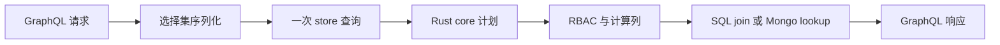

# store-graphql

**用你已经注册的 JSON schema 生成标准 GraphQL API——客户端一次请求，就变成一次 `store.query`。给已经用 common-store 定义数据模型、又不想再维护一套类型系统的团队用。**


中文文档（本页） · 生产护栏：[DEPLOYMENT.md](./DEPLOYMENT.md) · English: [README.md](./README.md)

- schema 是唯一事实源——没有第二套类型系统，没有手写 SDL。
- 每个字段都走 store 既有语义：RBAC、计算列、关系、方言路由。
- 当前发布：`0.6.2`（Node ≥ 18、Python ≥ 3.10，`go/` 下另有 v0 Go 适配器）。

## 一个屏幕，九个请求

周一 8:40，手机在地铁隧道里打开一个课程详情页。第一行字出现之前，应用已经发了九个请求：课程、分类、讲师、四节课、评价摘要、以及当前用户是否报名。

九个往返。九次超时机会。九次读同一个数据库，其中大部分还取回了屏幕根本不渲染的列。在 120 ms 的连接上，等待不是数据库造成的，是对话的形状造成的。

这个屏幕需要的是一棵树。客户端要的是九个列表。

`store-graphql` 把这棵树变成一个请求，把这个请求变成一次 `store.query`。它把你已注册的 JSON schema 反射成标准 GraphQL schema，把客户端的选择集序列化进数据层已有的 GQL 投影，再让 Rust core 在一次计划里解析嵌套字段、计算列、权限和方言差异。九个请求变成一个；服务端永远不为子列表另写一次查询。

## 它到底做什么

它是一层协议皮，不是数据层。store 知道的每个可写模型，它生成类型、两个查询根、三个变更根，然后把执行交回 REST 与 gRPC 皮肤共用的同一个引擎。

| 你在 JSON schema 里声明 | GraphQL 面得到 |
|---|---|
| 模型 `User` | `type User`、`getUser`、`listUser`、`createUser`、`updateUser`、`deleteUser` |
| `_id` | `ID!`；其余字段一律可空 |
| `string`、`datetime` | `String`——datetime 按 ISO 字符串透传 |
| `int` / `float` / `bool` | `Int` / `Float` / `Boolean` |
| 带 `fields` 的 `object` | 嵌套对象类型，名为 `<Parent>_<fieldPath>`，递归展开 |
| 无 `fields` 的 `object`、`array`、未知类型 | `JSON` 自定义标量 |
| `computes.<name>` | 按计算列声明的类型生成的普通字段 |
| `_score` | `Float`，可空，注入每个模型类型 |

单个模型生成的面长这样（两套 smoke 测试断言的就是这个形状）：

```graphql
type User { _id: ID! name: String age: Int _score: Float }

type Query {
  getUser(id: ID!): User
  listUser(condition: JSON, sort: JSON, limit: Int): [User!]!
}

type Mutation {
  createUser(input: JSON!): User
  updateUser(id: ID!, set: JSON!): User
  deleteUser(id: ID!): Boolean!
}
```

归档表（`User` 存在时的 `UserDeleted`）与以 `__` 开头的控制面模型会被过滤掉。`x-graphql: {hidden: true}` 整个移除模型；`{readonly: true}` 只生成查询侧。描述从 schema 原样进入 SDL 的三引号注释，于是 GraphiQL 与 `@graphql-codegen` 读到的是 schema 作者写的那份文档。

## 关键机制

### schema 就是类型系统

构建 schema 时，适配器调 `store.list()` 与 `store.get(name)` 并反射结果。没有会漂移的 SDL 文件，没有要维护的 resolver map。Node 的 `exportSDL(schema)` 与 Python 的 `export_sdl(schema)` 打印生成的 schema 供客户端 codegen；introspection 永远是活的真实来源。

### 投影下推：选择集就是查询

根 resolver 遍历 GraphQL 选择集，把它序列化回 store 自己的投影语法。这样一段请求：

```graphql
query($c: JSON, $l: Int) {
  listUser(condition: $c, limit: $l) {
    name
    profile { bio }
  }
}
```

到达 store 时就是一次调用：

```text
User($condition:@c0,$limit:@l) { name, profile { bio } }
params: { c0: { name: "alice" }, l: 10 }
```

Node 与 Python 都会展开 fragment、在序列化时求值 `@skip` / `@include`，空投影回退到 `_id` 以保证 GQL 串合法。v0 忽略输出别名。`limit` 缺省 50，超过 1000 抛带稳定前缀 `ERR_LIMIT:` 的错误，而不是静默截断；向量 `$near` 条件自带 `$near.$limit`，不能与根 `limit` 并用。

### 关系留在同一个计划里

这层皮肤不装 DataLoader，也没有逐父级的子 resolver。选中的嵌套子树就是那次下推投影的一部分，core 把声明的关系编译进同一条语句——SQL 后端是 `LEFT JOIN`，MongoDB 是聚合管道里的 `$lookup`。像 `lessonCount: { agg: { $count: "lessons" } }` 这样的计算聚合会作为类型上的普通字段出现，请求它不增加任何往返。

`0.6.2` 有一条限制：生成器反射 `fields` 与 `computes`。只写在 `defn.relations` 下的关系，core 能解析，但不会自动变成 GraphQL 字段。单查询链路已经通了，关系面的自动类型化还没有。在此之前，用计算聚合，或写一个调用 `store.query` 的 `Query` 扩展。

### RBAC 与错误的形状

适配器从不重新实现权限。`contextFactory`（Node）或 `context_provider`（Python）把 HTTP 请求变成 store 上下文；返回 `nil` / `None` 依然显式注入，所以身份不会跨请求泄漏。错误保留原始 message，并补一个机器可读的 code：

| 情形 | Node 上的 HTTP | `errors[0]` | `data` |
|---|---|---|---|
| core 错误带 `ERR_NOT_FOUND:` 前缀 | 200 | message 不变，`extensions.code = "NOT_FOUND"` | 字段为 `null` |
| 权限错误 `ERR_PERMISSION:` | 403 | message 不变，`extensions.code = "FORBIDDEN"` | 缺席 |
| 上下文缺失 `no_context` / `ERR_NO_CONTEXT:` | 403 | message 不变 | 缺席 |
| 其余 context hook 失败 | 401 | message 不变 | 缺席 |
| 深度、字段数或 introspection 守卫 | 400 | `ERR_DEPTH:` / `ERR_COMPLEXITY:` / `ERR_INTROSPECTION:` | 缺席 |

这是 `spec/04` 的 Node 参考映射。Python 的 `create_app` 把执行错误放进 200 响应体，只对 `context_provider` 失败套用 403/401 分流；它的请求守卫同样返回 400。`getX` 未命中不是错误：它返回 `null`。

## 跑起来

```bash
# Node
npm install store-graphql-node nodejs-store better-sqlite3 graphql
npm install graphql-yoga fastify  # 仅 createYoga / graphqlPlugin 需要

# Python
pip install store-graphql-py py-store aiosqlite
pip install 'store-graphql-py[fastapi]'   # 仅 create_app 需要
```

下面这段 Node 示例是 `node/test/e2e.real.test.js` 的精简版——真实 `nodejs-store`、真实 Rust core、内存 SQLite。

```javascript
const Database = require('better-sqlite3');
const { parse, execute } = require('graphql');
const { init, store, executors } = require('nodejs-store');
const { buildGraphQLSchema } = require('store-graphql-node');

(async () => {
  const db = new Database(':memory:');
  await init({ default: executors.createConnection('sqlite', db) });
  store.register({
    name: 'User', collection: 'users', idPrefix: 'u',
    fields: { _id: { type: 'string' }, name: { type: 'string' }, age: { type: 'int' } },
  });
  db.exec(store.generateDdl('sqlite', ['User']));
  db.exec(store.generateDdl('sqlite', ['UserDeleted']));

  const schema = buildGraphQLSchema(store);
  await execute({
    schema,
    document: parse('mutation($i: JSON!) { createUser(input: $i) { _id } }'),
    variableValues: { i: { name: 'alice', age: 30 } },
  });
  const result = await execute({
    schema,
    document: parse('query($c: JSON, $l: Int) { listUser(condition: $c, limit: $l) { _id name } }'),
    variableValues: { c: { name: 'alice' }, l: 10 },
  });
  console.log(result.data.listUser);
})();
```

Python 示例对应 `py/tests/test_e2e_real.py`——注意 `executescript` 前的 `await`，以及 core 在插入前应用的 `deletedAt` 缺省值。

```python
import asyncio
import aiosqlite
import py_store
from graphql import parse, execute
from store_graphql import build_graphql_schema

async def main():
    async with aiosqlite.connect(":memory:") as db:
        await py_store.init({"default": py_store.executors.create_connection("sqlite", db)})
        py_store.store.register({
            "name": "User", "collection": "users", "idPrefix": "u",
            "fields": {"_id": {"type": "string"}, "name": {"type": "string"},
                       "age": {"type": "int"}, "deletedAt": {"type": "int", "default": 0}},
        })
        await db.executescript(py_store.store.generate_ddl("sqlite", ["User"]))
        await db.executescript(py_store.store.generate_ddl("sqlite", ["UserDeleted"]))

        schema = build_graphql_schema(py_store.store)
        await execute(schema, parse('mutation($i: JSON!) { createUser(input: $i) { _id } }'),
                      variable_values={"i": {"name": "alice", "age": 30}})
        result = await execute(schema, parse('{ listUser { _id name deletedAt } }'))
        print(result.data["listUser"])

asyncio.run(main())
```

HTTP 承载：Node 提供 `graphqlPlugin(fastify, { store })`，Python 提供 `create_app(store)`；两者缺省都在 `/graphql`，`GET` 出 GraphiQL，`POST` 执行。

```bash
curl -s http://localhost:4000/graphql \
  -H 'content-type: application/json' \
  -d '{"query":"{ listUser { _id name } }"}'
```

## 边界：什么时候不要用它

- **需要订阅。** 没有。store 没有订阅语义，这层皮肤也不发明。
- **需要 offset 分页或 count 根。** `listX` 只暴露 `limit`；`skip` / `page` 和 `countX` 不生成。
- **指望关系自动出现。** `0.6.2` 只类型化 `fields` 与 `computes`，`defn.relations` 不自动暴露。
- **想内联 JSON 参数。** `condition`、`sort`、`input`、`set` 只接受变量，内联字面量被刻意拒绝。
- **依赖输出别名。** v0 按字段名序列化，丢弃别名。
- **匿名暴露。** core 把缺失上下文当作「跳过权限检查」。上公网前配好上下文钩子，并打开 `setRequireContext(true)`。
- **客户端会发病理文档。** 深度上限 10，字段数上限 300，请求体上限 1 MB；可用 `introspection: false` 关掉 introspection。

## 在家族里的位置

它是同一份 JSON schema 之上的 GraphQL 皮肤，与 REST 皮肤（[store-api](https://github.com/coenddt/store-api)）、gRPC 皮肤（[store-grpc](https://github.com/coenddt/store-grpc)）、MCP 皮肤（[store-mcp](https://github.com/coenddt/store-mcp)）同源；[store-gateway](https://github.com/coenddt/store-gateway) 把它们组合在一个入口后面。它跑在 [nodejs-store](https://github.com/coenddt/nodejs-store) 与 [py-store](https://github.com/coenddt/py-store) 上，`go/` 下有 v0 [go-store](https://github.com/coenddt/go-store) 适配器；权限、计算列、关系、命令规划、SQL 方言等语义都在 [rust-store](https://github.com/coenddt/rust-store)。

## 一图看懂



三句话：schema 即类型系统；选择集直接变成一次下推查询；关系、权限、计算列都留在同一个计划里。

MIT —— 见 [LICENSE](./LICENSE)。
